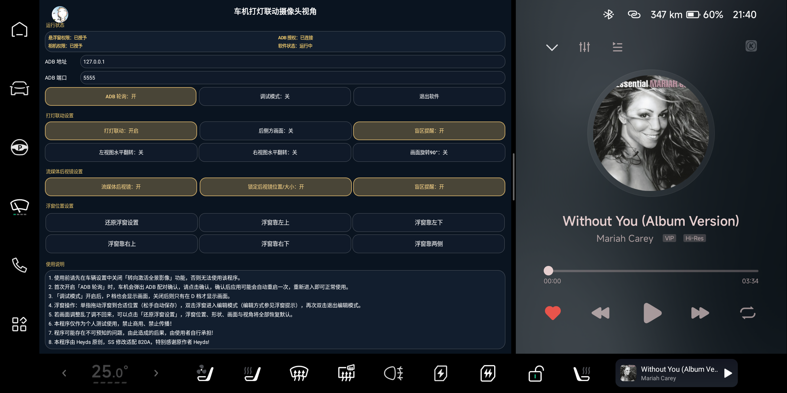

# P7_ViewAssist · 820A 分支

小鹏 P7（**820A / E28，Android 9**）车机的「打灯转向辅助 + 流媒体后视镜 + 盲区提示」实现。

本项目是 [Hades-Heyds/P7_ViewAssist](https://github.com/Hades-Heyds/P7_ViewAssist) 的 **820A 分支**：
上游项目面向 8295 平台（Android 10），本分支针对 820A 重新适配了相机与 AVM 接口、
权限流程、浮窗渲染与状态检测，并在此基础上增加了后视镜、盲区提示等扩展功能。

> 仅供个人学习研究，禁止商用、禁止传播。详见文末免责声明。



## 功能

| 功能 | 说明 |
|---|---|
| 打灯联动侧视 | 打转向灯自动弹出对应侧盲区画面（D 档；调试模式可 P 档） |
| 后侧方画面 | 使用后侧方鱼眼画面代替纯侧视画面 |
| 画面旋转 90° | 竖向浮窗（540×960），适合竖屏视野 |
| 左右水平翻转 | 左右视图镜像，方便对照 |
| 流媒体后视镜 | 调用后视摄像头做常驻后视浮窗，可移动/缩放/锁定/双击编辑 |
| 盲区提示 | 读取 `SCU_BSD_LEFT/RIGHT_WARNING`：后视镜左右红色竖条、侧视浮窗「⚠ 注意盲区」闪烁 |
| 浮窗预设 | 还原 + 靠左上/左下/右上/右下/两侧 五种位置 |
| 状态面板 | 悬浮窗权限、相机权限、ADB 授权、软件运行状态（两列显示） |
| ADB 轮询总开关 | 关闭后完全不执行 ADB 命令，零后台开销 |
| 保护逻辑 | 双闪抑制侧视、倒车让位、原厂 360 让位、非 D 档收起 |

## 与上游（8295 版）的主要差异

| 项目 | 上游 8295 | 本分支 820A |
|---|---|---|
| 系统 | Android 10 | Android 9 / API 28 |
| 相机 | 8295 相机栈 | `Camera1.open(2)` + 厂商 `setCmdControlParameters`，Camera2 兜底设置 AVM 模式 |
| AVM 模式 | `setAvmDisplayMode` | `AVM_DISPLAY_MODE` 属性 + 模式 8/17/21/22 切换 |
| 状态检测 | L/R 转向灯属性 | 转向灯 + 档位 + 前台包名 + AVM 模式 + BSD 属性，多路合并一次查询 |
| 浮窗 | 基础浮窗 | 圆角、边框、拖动/缩放、旋转、翻转、位置预设、锁定 |
| 其他 | — | 流媒体后视镜、盲区提示、ADB 轮询开关、CPU 优化 |

## 目录结构

```
src/com/xiaopeng/qa/camera/   本项目新增/重写的 Java 代码
smali/com/xiaopeng/qa/camera/ 对基础 APK 的 smali 修改（服务、监控、主界面）
tools/build.ps1               构建脚本（APK 注入式，需要自备基础 APK）
docs/功能说明.md               完整功能与实现说明
docs/screenshots/             界面截图
release/                      已构建的 APK
```

## 构建说明

本项目**不是 Gradle 工程**，而是「基础 APK + smali 修改 + Java 补丁类注入」的方式构建：

1. 自备基础 APK（820A 车机版，本项目不提供分发）；
2. `apktool d` 反编译基础 APK；
3. 用 `smali/` 下的文件覆盖对应 smali；
4. `javac` 编译 `src/`（需 `android.jar`，API 28）→ `d8` 生成 `classes2.dex`；
5. 将 `classes2.dex` 注入 APK，`zipalign` + `apksigner` 签名。

`tools/build.ps1` 是作者本地使用的脚本，路径需按实际情况修改。

## 使用说明

1. 使用前请先在车辆设置中关闭「转向激活全景影像」功能，否则无法使用该程序。
2. 首次开启「ADB 轮询」时，车机会弹出 ADB 配对确认，请点击确认，确认后应用可能会自动重启一次，重新进入即可正常使用。
3. 「调试模式」开启后，P 档也会显示画面，关闭后则只有在 D 档才显示画面。
4. 浮窗操作：单指拖动浮窗到合适位置（松手自动保存），双击浮窗进入编辑模式（编辑方式参见浮窗提示），再次双击退出编辑模式。
5. 若画面调整乱了调不回来，可以点击「还原浮窗设置」，浮窗位置、形状、画面与视角将全部恢复默认。
6. 本程序仅作为个人测试使用，禁止商用、禁止传播！
7. 程序可能存在不可预知的问题，由此造成的后果，由使用者自行承担！
8. 本程序由 Heyds 原创，SS 修改适配 820A，特别感谢原作者 Heyds！

## 免责声明

- 本项目为个人学习研究项目，与小鹏汽车无任何隶属关系，非官方应用。
- 使用需要车机已开启 ADB 与悬浮窗权限；请自行评估风险。
- 因使用本项目造成的问题，作者不承担责任。
- 上游项目未提供开源许可证，本分支不主张对上游代码的所有权；如涉及版权问题请联系删除。
- `release/` 中的 APK 使用应用内自签名密钥，不含任何个人密钥。

## 致谢

- [Hades-Heyds/P7_ViewAssist](https://github.com/Hades-Heyds/P7_ViewAssist) —— 原始思路与 8295 实现
- SS —— 820A 适配
- 所有在社区分享 P7 车机调试经验的朋友

---

## English summary

A fork of [P7_ViewAssist](https://github.com/Hades-Heyds/P7_ViewAssist) adapted for the
XPeng P7 **820A** head unit (Android 9). It adds turn-signal side-view overlays,
a streaming rear-view mirror, BSD (blind-spot) warnings, rotation/mirror toggles,
window presets, an ADB polling master switch and CPU optimisations.

Built by patching a base APK (smali) plus injected Java helper classes — not a Gradle project.
For personal/educational use only. Non-commercial. Use at your own risk.
